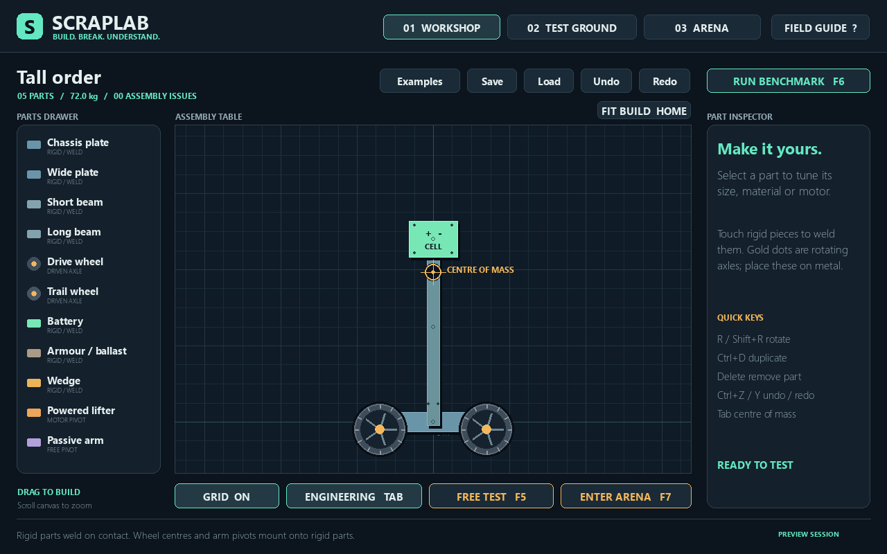
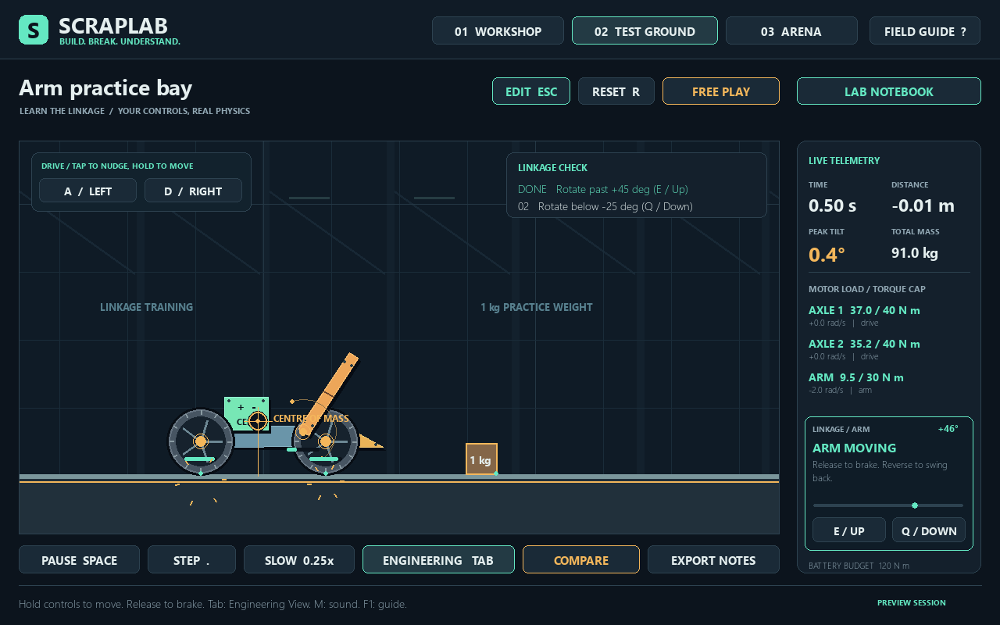
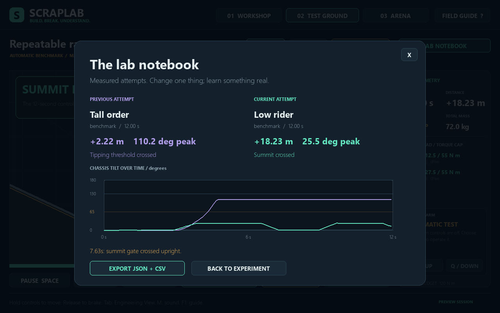

# ScrapLab: Build. Break. Understand.

Build a robot. Find its weak point. Change one thing. Try again.

ScrapLab is an offline Python desktop engineering game with a visual workshop, a real rigid-body test ground, and a small robot arena. The central feature is Engineering View: it exposes the centre of mass, axle locations, contact points and measured motor loads so a failed design becomes an experiment.



## Start here — playing and grading

This repository contains the complete Python source. **GitHub displays the code; the game runs locally on your computer.**

1. Download the repository using **Code > Download ZIP** and extract it, or clone it.
2. Install Python 3.11+ (tested on Python 3.14.7).
3. On Windows, double-click **setup.cmd** once with internet access to install the pinned dependencies into a local `.venv`.
4. Double-click **launch.cmd** to play. After setup, the game works offline.

The entry point is [`main.py`](main.py); the game code is in [`scraplab/`](scraplab/). For a quick demonstration, follow [the 60–90 second demo](docs/DEMO_SCRIPT.md). The [validation record](docs/VALIDATION.md) and [physics explanation](docs/EXPLAIN_IT.md) describe the tests and design. The original teacher instructions are preserved in [docs/CHALLENGE.md](docs/CHALLENGE.md).

## Assignment submission

| Required field | Submission |
| --- | --- |
| Project name | **ScrapLab: Build. Break. Understand.** |
| Project description | A 2D robot construction sandbox. Assemble working machines from plates, beams, wheels, batteries, armour, wedges and arms. Test them on an incline, inspect their centre of mass and motor loads, compare measured attempts, then compete in a ring-out arena. |
| Python libraries used | **pygame-ce 2.5.8** for the window, input and procedural graphics; **Pymunk 7.3.1** for rigid-body physics. Pymunk dependencies: cffi 2.1.1 and pycparser 3.12. Standard library modules handle JSON, CSV, paths, math and tests. |
| GitHub repository / project link | [skittleWatts/Python-Vibe-Coding-Challenge-2627-S1](https://github.com/skittleWatts/Python-Vibe-Coding-Challenge-2627-S1) |
| Instructions for running | Install Python, download/clone this repository, run **setup.cmd** once, then **launch.cmd**. Detailed terminal/PyCharm instructions follow. |

The challenge allows AI assistance. This implementation was developed with AI assistance from the supplied project vision. Read the explanation guide, make your own design changes, and describe your actual contribution honestly. The supplied demonstration and results are generated by the physics engine, not a scripted success animation.

## Run it

### This prepared Windows folder

Double-click `launch.cmd`. It uses `.venv\Scripts\python.exe` and starts the game. Internet access is not needed after setup. There are no external assets, accounts, services, AI models, or audio-device requirements.

To make the game easier to reach, create a desktop shortcut to `launch.cmd`; keep the launcher in its project folder. This is **version 1.1**, with arm practice, visible motor feedback, mouse controls and automatic draft recovery.

The verified environment is **Windows / CPython 3.14.7 / pygame-ce 2.5.8 / Pymunk 7.3.1**. Python 3.11+ is the intended minimum, but other Python/OS combinations have not been tested here.

### New computer or extracted source ZIP

1. Install Python 3.11+ (3.14 recommended for matching this test environment), with Python on PATH.
2. Extract the entire project into a writable local folder.
3. Double-click `setup.cmd` while connected to the internet. It creates `.venv` and installs the pinned dependencies from PyPI. It does not install packages globally.
4. Double-click `launch.cmd`.

The source ZIP intentionally excludes the machine-specific `.venv`. Do not move or copy a virtual environment to another machine; rerun setup in the new location.

### PowerShell

From the ScrapLab folder:

```powershell
# First installation only:
python setup_env.py

# Launch using the explicit dedicated interpreter:
.\.venv\Scripts\python.exe main.py

# Meaningful automated checks:
.\.venv\Scripts\python.exe -m unittest discover -s tests -v

# Reproduce the actual 12-second comparison without opening a window:
.\.venv\Scripts\python.exe verify_demo.py

# Regenerate screenshots and raw benchmark data:
.\.venv\Scripts\python.exe verify_demo.py --artifacts
```

### PyCharm

1. Run **setup.cmd** once if you have not already done so.
2. Use **File > Open** and select this repository folder containing this README and `main.py`.
3. In **Settings > Python > Interpreter**, select the existing local interpreter at `.venv\Scripts\python.exe` inside this repository.
4. Open `main.py`, right-click it and choose **Run 'main'**, or click the green Run triangle with `main.py` open. Set the working directory to this repository folder if creating a manual run configuration.

The project resolves saves/examples relative to its own source folder, so it also works when launched from a different working directory. pygame-ce imports as `pygame`; do **not** also install the separate `pygame` distribution into this environment.

## Build controls

| Action | Control |
| --- | --- |
| Add a part | Drag it from the parts drawer into the assembly table |
| Select / move | Click / drag a placed part |
| Rotate | **R**, or **Shift+R** for the other direction, 15° per press |
| Duplicate / delete | **Ctrl+D** / **Delete** |
| Undo / redo | **Ctrl+Z** / **Ctrl+Y**, up to 80 edits |
| Snap / zoom | **G** toggles a 0.10 m grid; scroll over the canvas to zoom |
| Fit the whole build | **Home**, or **Fit Build** |
| Tune a part | Inspector **+ / -** controls; click material/control/direction to cycle |
| Save / load | **Ctrl+S** / **Ctrl+O**, or the toolbar buttons |
| Choose a starting point | **Examples**: Tall order, Low rider, Forklift, Blank |
| Inspect mass | **Tab** toggles Engineering View |
| Free test / benchmark / arena | **F5 / F6 / F7**, or the visible buttons |
| Help | **F1** |
| Sound | **M**, or the Field Guide sound button; optional, off by default |

Rigid parts connect automatically when their geometry touches or overlaps, with a 0.055 m mount tolerance. A beam is a mounting rail: a battery overlapping a beam is intentional. Two batteries, ballast blocks or wedges deeply intersecting each other are flagged. Deeply overlapping chassis plates and intersecting wheels are also rejected. Disconnected parts turn red. Invalid designs can be saved as drafts but cannot enter simulation.

Wheels have integrated motorized axles. Their **centre dot** must be on rigid metal. Arms hinge at their **left end before rotation**; that dot must be on rigid metal. A passive arm is a beam on a freely rotating pivot, with no motor. Arms do not carry additional child parts in this version.

Alloy/steel/foam affect structural mass. Wheel size, grip multiplier, motor speed, torque, direction, control assignment, battery placement and wheel spacing all affect the actual simulation. Size scales both dimensions together, from 0.5x to 1.8x. Dimensions, mass and units are shown in the inspector. There is a 60-part maximum.

## Test and compete

| Action | Control |
| --- | --- |
| Drive | Hold **A / D** or left / right arrows; click or hold the visible drive buttons |
| Raise / lower the arm | Hold **E / Up** to raise, **Q / Down** to lower a default right-facing arm |
| Use the mouse for the arm | Click **E / UP** or **Q / DOWN** for a small nudge; hold for continuous motion |
| Learn the linkage | **Arm Practice**, or select the arm and click **Try in Practice Bay** |
| Pause / resume | **Space** |
| Single physics step | **.** (period); advances exactly 1/240 s and stays paused |
| Slow motion | **L**, or the **Slow 0.25x** button |
| Reset | **R**; rebuilds the original design and scenario |
| Return to workshop | **Esc**; simulation does not alter the blueprint |
| Compare / export | **Lab Notebook / Compare / Export Notes** |

### Getting the controllable linkage moving

Choose **Examples > Forklift**, then **Arm Practice**. Hold **E** or **Up** to lift; hold **Q** or **Down** to lower. You can also use the two buttons below the arm angle gauge. The practice check asks you to move the actual joint past +45° and below -25° relative to its starting mount angle; it stays open for free play after you succeed.

For a custom build, use the **powered lifter**, attach its pivot to the frame, include an attached battery, set its control to **ARM E/Q**, and give it positive torque and speed. A **passive arm** has no motor. **DRIVE A/D** assigns an arm to the drive keys, while **OFF** lets it move freely. Reversing a motor changes its direction. The arm status explains missing power, a disabled motor, its control assignment, a joint stop, or a measured torque limit. A loaded arm can stall if its available torque is insufficient.

The **automatic benchmark disables manual input**. Click **Free Play** to take control. Also check that the game has focus and is not paused; switching windows pauses a running simulation and clears held commands. Resume with **Space** or the visible Resume button. The AI uses the same motor and battery limits as you.



The test ground has flat floor, a roughly 25° incline, a summit gate, a descent, an obstacle and 3 kg / 8 kg movable weights to the **left** of spawn. Use a lifter to explore contact and leverage. No chassis velocity or position is changed to make it drive.

The benchmark runs 12 simulated seconds: settle 0.6 s, increase the drive command over 0.8 s, then hold forward. Manual drive input is ignored only during this explicitly labelled benchmark. Its outcome still comes entirely from the physics. Free Test is manually controlled. The notebook warns if the two attempts have different scenarios or durations. Export keeps the last 20 recorded attempts plus the current run as JSON/CSV in `lab_notes/`; exports replace the previous export files.

The arena starts with a 2-second countdown. Copperhead uses the same parts, physics builder, battery budget and motor limits as the player. It steers toward you and away from the arena edges. Win by making its total centre of mass fall below -2 m, or keeping its chassis more than 100° from upright for 3 continuous seconds. After 45 seconds of play the result is a draw. Both robots can lose simultaneously. There are no hidden health bars or damage multipliers.

### Keeping your work

The current blueprint is recovered automatically the next time you open the game. Recovery writes to `session/recovery.json` about every three seconds after changes, outside an active drag, and on normal exit. **Ctrl+S** still saves a named design in `saves/`; **Ctrl+O** opens your library. Recovery is one rolling draft, so use named saves to keep multiple designs. Your sound preference is stored in `session/preferences.json`. Notebook attempts stay in memory for the current session; export important measurements before closing.

For previews, `--no-recovery` skips both reading and writing the recovery draft. `--preset Forklift --practice --no-intro` opens the arm lesson directly. An explicit `--preset` replaces the loaded draft; an ordinary launch restores it.

## A reliable experiment

1. Load **Tall order**. Press **F6** and let the full 12-second test finish.
2. Press **Tab** to see the centre of mass and axles. The chassis has crossed the measured 65° tipping threshold.
3. Press **Esc**. Drag the green battery straight down the mast to the marked low mount, about **y = 0.4 m** with snapping on. Keep x = 0 and leave the other parts unchanged.
4. Press **F6** again. The machine reaches the summit upright.
5. Open **Compare** to see both peak tilts and traces. Save your improved design, then enter the arena.

Verified results for the bundled JSON examples, using the installed versions:

| Design | Battery y | 12 s displacement | Peak tilt | Result |
| --- | ---: | ---: | ---: | --- |
| Tall order | 2.40 m | 2.22 m | 110.2° | Tipped; summit not reached |
| Low rider | 0.38 m | 18.23 m | 25.5° | Summit crossed at 7.63 s |

The actual desktop drag test at y = 0.40 m also succeeded: **18.25 m**, **25.5°**, summit at **7.64 s**. Small changes in placement may change the numbers. Both designs weigh about **72.0 kg**, use the same wheels and 55 N m motor limits, and receive identical benchmark controls. Only the battery location changes. Raw bundled-preset results are in `docs/benchmark_results.json`.



## How the project fits together

| File | Responsibility |
| --- | --- |
| `main.py` | Small application entry point |
| `scraplab/parts.py` | Catalogue, geometry, dimensions, planar material density and mass |
| `scraplab/blueprint.py` | Plain dataclasses, presets, attachment validation and versioned JSON |
| `scraplab/editor.py` | Selection, dragging, edits, undo/redo |
| `scraplab/physics.py` | Compound rigid body, real pivots/motors, terrain, fixed stepping and arena rules |
| `scraplab/scenarios.py` | Repeatable benchmark inputs and the opponent controller |
| `scraplab/telemetry.py` | Measurements and threshold events |
| `scraplab/render.py` | Procedural geometry drawing, cameras, material treatment and overlays |
| `scraplab/app.py` | Window, UI controls, screen states, input and game loop |
| `scraplab/hud.py` | Simulation controls, gauges, match clock and result explanations |
| `scraplab/feedback.py` | Measured arm status and clear reasons a motor cannot move |
| `scraplab/storage.py` | Automatic draft recovery and local preferences |
| `scraplab/audio.py` | Optional synthesized interface, impact and outcome tones |
| `tests/` | Data, physics and pygame-event integration checks |
| `verify_demo.py` | Reproducible demonstration/report generator |

`prototype.py` is the small first-stage physics prototype kept for learning. It is not the main game.

## Physics model and honest limits

- **Units:** metres, kilograms, seconds, radians and newtons. Screen pixels are a separate camera scale. The displayed torque unit `N m` means newton-metres.
- **Mass/inertia:** area times a documented planar density; circles use circular area and wedges use triangle area. Compound centre of mass is mass-weighted, including a wedge's actual centroid. Moment of inertia uses the corresponding shape geometry about that centre.
- **Rigid construction:** all connected welded parts share one compound rigid body. Each wheel/arm has its own body and a pivot constraint. Arms also have relative angular stops at -65° and +100° from the blueprint orientation.
- **Drive:** Pymunk SimpleMotor acts between the frame and rotating part. `max_force` is the torque cap for this angular constraint. The frame receives reaction torque. Ground friction produces translation; spinning wheels in the air cannot produce net horizontal momentum.
- **Time:** every physics step is 1/240 s, with an accumulator independent of rendering. Long wall-clock stalls are capped to 0.10 s to avoid an uncontrolled catch-up. This loses real time rather than taking oversized physics steps. No continuous collision detection is implemented; extremely thin parts at high speeds may tunnel.
- **Power abstraction:** each attached battery allows 120 N m of total configured motor torque. If demand exceeds this, every enabled motor's cap is scaled proportionally. No battery means no powered motors. A zero command applies a finite motor brake; control **OFF** disables that motor and lets it freewheel. There is no voltage/current/heat/energy depletion simulation. The battery is intentionally heavy to make balance easy to demonstrate.
- **Contacts:** same-robot parts ignore each other's collisions as if mounted in adjacent depth layers. They still collide with the terrain, weights and the other robot. Structural mounting overlap is intentional. An arm can pass through its own chassis in this approximation.
- **Measurements:** live motor torque is the solver's last angular impulse divided by the fixed timestep: a load estimate, not a stress analysis. Teal dots show solved contacts; they are not force vectors. Sparks are emitted from measured first-contact impulses above a threshold. No fabricated failure explanation is generated.
- **Scope:** 2D planar mechanics with simplified material densities, Coulomb friction and constant torque caps. There is no 3D chassis width, electrical circuit simulation, tyre deformation, suspension, springs, sliders, spinners, destructible parts, or breakable welds. Physical tipping and ring-outs are the failure model. Sound is optional and the game works without audio hardware.
- **Editor limits:** uniform scaling rather than arbitrary polygon drawing; automatic rigid welding and integrated axle modules rather than editable connection graphs. No attachment chains on moving arms. Use Home / Fit Build for large or off-centre designs. Automatic recovery retains one draft; named saves retain individual designs.
- **UI:** designed at 1280x800 and scaled with letterboxing when resized. Input mapping is tested at 960x600; a 1280x800 or larger display is recommended. Fonts fall back to installed system fonts.

## Personalize it and explain it

Start with [the explanation guide](docs/EXPLAIN_IT.md) and [the 60–90 second demonstration script](docs/DEMO_SCRIPT.md). Change the catalogue colors or densities in `parts.py`, edit the built-in recipes in `blueprint.py`, change terrain/control timing in `scenarios.py`, or tune `GRAVITY` and `DT` in `physics.py`. Make one change at a time and use the notebook to explain what it did.

Try a wide low machine, a reversed wheel, a foam mast versus steel, a passive pivot, or a high-grip trail wheel. Save your own named design. These are useful personal contributions because you can show a before/after result and explain the mechanism.

## Verification and dependencies

See [VALIDATION.md](docs/VALIDATION.md) for the actual checks and desktop demonstration record. `requirements.txt` records the exact installed/tested package versions. `pip check` passed. The environment contains pygame-ce only, with no conflicting pygame distribution.

API choices were checked against the official [pygame-ce documentation](https://pyga.me/docs/), [Pymunk API reference](https://www.pymunk.org/en/latest/pymunk.html), and [Pymunk constraint documentation](https://www.pymunk.org/en/latest/pymunk.constraints.html), then exercised against the installed versions. Online documentation may describe a different latest patch version; the pins above are the versions actually tested here.

All game visuals are original procedural drawing instructions; no downloaded game assets are used. Third-party libraries retain their own licences (pygame-ce LGPL, Pymunk MIT, CFFI MIT, pycparser BSD). No third-party source was copied into this project.
