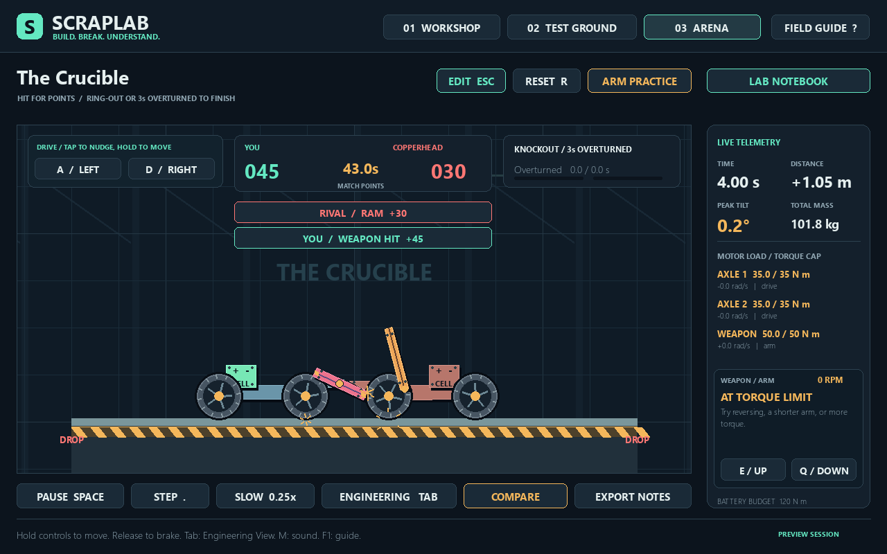

# ScrapLab 1.2: Battle Works

Open **Examples** and choose **Whirlwind / Spinner** or **Kickback / Flipper**. Both are editable robots made from the same parts available in the drawer. Your previous build is available through Undo.

Press **F7** or click **Arena** to open the battle lobby. Choose Copperhead, Whirlwind or Kickback, then click **Start Match** or press **Enter**. The lobby shows your saved wins, losses, draws, best match score, current win streak and career rank.

## New weapons

- **Spinner bar:** a heavy rectangular rotor with a centre-mounted axle and unrestricted rotation. Hold **E / Up** to spin, **Q / Down** to reverse; release to apply the finite motor brake. It needs space to spin up, and can stall against a robot. Back away and attack again. The weapon panel shows actual RPM.
- **Power flipper:** a short, thick paddle with a pivot at its left end. It trades reach for lifting leverage. **E / Up** raises a default right-facing paddle; **Q / Down** resets it. It retains the -65° / +100° joint stops. More torque still means more reaction on the chassis.

Both use the existing battery torque budget. Their geometry, mass, inertia, collision response and motor limits are simulated. They do not apply scripted knockback or change an opponent's health. You can tune size, torque, speed, grip, control assignment and motor direction in the inspector.

## Scoring

| Event | Points |
| --- | ---: |
| Clean ram | 10–30 |
| A powered weapon's shape lands the hit | +15 |
| Win by ring-out or three seconds overturned | +250 |
| Ground bump, scraping, or resting contact | 0 |

A qualifying hit starts a new contact between opposing robots, has at least 0.8 m/s closing speed and a measured impulse of at least 5 N s. The base award is `10 + min(20, int(impulse / 4))`. The body moving into the contact receives credit; near-equal head-on contributions can score for both. A 0.55-second per-robot cooldown groups multi-part contact and suppresses jitter farming. These are arcade scoring thresholds, not a structural damage calculation.

Ring-outs and knockouts still end the match immediately. After 45 seconds of play, the higher impact score wins; equal scores draw. The two-second countdown gives no points. Restarting or leaving an unfinished match gives no career credit. A finished match is recorded once.

Rivals use the same parts, motor limits and scoring. They cycle their lifters, keep their spinners running, and reverse briefly if a push stalls before approaching again. No difficulty stat boosts are applied.

## Local battle record

Completed matches update `session/arena.json`, already covered by the project's existing ignore rules. Career points grant titles: Rookie Builder, Scrap Fighter at 250, Arena Engineer at 750, and Crucible Ace at 2,000. These are cosmetic titles; nothing locks weapons or upgrades behind a grind. Preview mode (`--no-recovery`) does not read or write this record.

The setup scripts, requirements, Python environment configuration and launcher are unchanged by this update.
